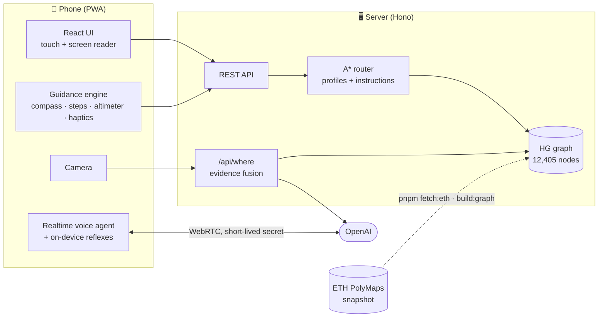

<div align="center">


# PolyGuide

**Accessible indoor navigation for ETH Zürich, usable by voice alone or by screen alone.**

PolyGuide guides blind, low-vision and wheelchair users through ETH's main building (HG) from any room to any room. It uses ETH's own routing network, the phone's sensors and camera, and a voice agent you can just talk to.


[How it works](#how-it-works) · [Quick start](#quick-start) · [Configuration](#configuration) · [Deploy](#deploy) · [Limits](#honest-limits)

</div>

---

> [!IMPORTANT]
> PolyGuide **supplements** a white cane or guide dog. It does not replace them. It does not detect obstacles and never says a path is clear.

## Why

ETH's main building has 15 floors and half floors, 580 rooms, and its room signs are small plates beside the doors. For someone who can't read those plates, or can't take the stairs, getting to a lecture hall on time is a real problem.

PolyGuide fixes that with one tap and one sentence:

> *"I use a wheelchair. I'm at the main entrance, take me to the Audimax."*
>
> *"Starting. 79 metres, about 2 minutes. No stairs. Uses 1 elevator."*

## Features

| | |
|---|---|
| ♿ **Routes that fit your needs** | A* over ETH's PolyMaps network with composable profiles: wheelchair (no stairs, escalators or steep paths), blind and low vision (fewer, simpler turns), and "avoid stairs" for a sprained ankle or luggage. |
| 🗣️ **Talk to it** | A speech-to-speech agent (OpenAI Realtime over WebRTC) plans trips, changes settings and answers "where am I?". Every action also works by touch. |
| ⚡ **Instant reflexes** | "Stop", "be quiet", "next", "emergency" run on the device the moment they're heard, even mid-sentence, with no wait for the AI. |
| 📷 **Reads signs like a person** | Point the camera and ask. It reads room signs, checks them against where you probably are and the floor you're on, and compares ETH's own room photos. |
| 🛗 **Knows the floor without a barometer** | Elevator rides measured from the accelerometer, stairs counted step by step, and GPS altitude when it's good enough. |
| 🧭 **Guidance without looking** | Compass arrow and a stereo audio beacon ("turn until the tick is centred"), a vibration pattern for each kind of step, and spoken warnings a few metres before stairs and doors. |
| 🛡️ **Honest when unsure** | One camera reading can never move you far or to another floor on its own. A second witness is needed: another frame, the route, or your "yes". |
| ✅ **Built-in system check** | Say "system check" to test the mic, camera, sensors, AI and routing live, with timings. Each warning says what still works without that part. |

## How it works



**Code decides where to go. AI only perceives and phrases.** The route and every step are deterministic. The AI reads signs, describes what the camera sees and turns guidance into natural speech. Guidance never waits for it.

1. **Data.** ETH's PolyMaps ArcGIS layers (pathways, transitions, rooms, landmarks, POIs) are downloaded once and committed to `data/hg/`. The app never calls ETH at runtime.
2. **Graph.** `pnpm build:graph` projects every vertex to local metres, merges nodes floor by floor and attaches 580 rooms, 14 entrances and 180 points of interest to their nearest door node.
3. **Routing.** A* with a binary heap. Each profile is a set of cost modifiers (`edgeCost = baseTime × Π multipliers + Σ penalties`, any `∞` forbids the edge), so needs combine freely.
4. **Instructions.** Turns are classified from geometry and collapsed into steps, each with a screen string ("Turn left, then go 24 m to the elevator") and a speech-safe one ("Turn left. Then go about 25 metres to the elevator.").
5. **Where am I?** One camera call reads signs, the floor letter and the kinds of landmark in view. These are fused with walking distances from your last known position, so a misread sign across the building doesn't beat the plausible room next door.
6. **Voice.** The browser connects straight to OpenAI Realtime with a 10-minute client secret. The API key stays on the server. Before every reply the agent gets a live state block: position, heading, route step and the room doors around you. It has 13 tools, including `look`, `set_position`, `identify_room`, `plan_trip` and `report_elevator_broken`.

## Quick start

**Requirements:** Node ≥ 20, Corepack (ships with Node), and a phone on the same network. An OpenAI API key is optional: without it, routing, navigation, settings and haptics all still work.

```bash
git clone git@github.com:TRBF/polyguide.git
cd polyguide
corepack enable                          # provides the pinned pnpm
pnpm install
cp apps/server/.env.example apps/server/.env   # add OPENAI_API_KEY if you have one

pnpm dev:server                          # API on :8787
pnpm dev:web                             # app on https://localhost:5173 (proxies /api → :8787)
```

Open the app on your phone at `https://<your-laptop-ip>:5173` and tap **Start**. The camera, motion sensors and mic need HTTPS, which the dev server provides with a self-signed certificate. A tunnel (`cloudflared`, `ngrok`) also works.

> [!TIP]
> Not walking around HG right now? Add **`?demo`** to the URL (or Settings → **Demo walk**). The route advances at walking pace by itself and elevator rides go through the floor sensor.

<details>
<summary><b>More dev commands</b></summary>

```bash
pnpm --filter @polyguide/web dev:http          # plain HTTP on :5174 for desktop testing
pnpm --filter @polyguide/server dev:mock        # serve fixtures instead of the real graph
pnpm --filter @polyguide/server start:app       # build the web app and serve everything on one port
pnpm route "HG E 41" "HG F 30" wheelchair       # route from the command line
pnpm fetch:eth && pnpm build:graph              # re-download the ETH snapshot and rebuild the graph
pnpm typecheck                                  # all packages
pnpm test                                       # 277 tests (routing, server, web)
```

</details>

## Configuration

All settings live in `apps/server/.env`. See [`.env.example`](apps/server/.env.example) for the tested defaults and notes on each model.

| Variable | Default | Purpose |
|---|---|---|
| `OPENAI_API_KEY` | *(empty)* | Enables the camera, voice agent and speech to text. Without it, everything else still works. |
| `OPENAI_VISION_MODEL` | `gpt-5.4-mini` | Reads room signs (~2–2.6 s per photo). |
| `OPENAI_TEXT_MODEL` | vision model | Parses typed and spoken commands. |
| `OPENAI_STT_MODEL` | `gpt-4o-mini-transcribe` | Speech to text for voice commands. |
| `OPENAI_EMBED_MODEL` | `text-embedding-3-small` | Matches photos against surveyed reference spots. |
| `OPENAI_REALTIME_MODEL` | `gpt-realtime-2.1` | The conversational voice agent. |
| `OPENAI_REALTIME_VOICE` | `marin` | The agent's voice. |
| `USE_MOCK` | `0` | `1` serves fixtures on every endpoint. |
| `SURVEY_TOKEN` | *(empty)* | Lets the team capture reference spots. Leave empty on public deployments. |
| `HOST` / `PORT` | `127.0.0.1` / `8787` | Where the API listens. |
| `SERVE_WEB` | `0` | `1` also serves the built web app from the API server. |
| `TRUST_PROXY` | `0` | `1` behind a reverse proxy, so rate limits use its user header. |

## Deploy

The Docker image builds the web app and serves app and API together on port 8080.

```bash
cp apps/server/.env.example apps/server/.env    # set OPENAI_API_KEY
docker compose up -d --build
curl http://localhost:8080/api/health
```

Put it behind anything that terminates TLS. Phones won't grant camera, mic or motion access over plain HTTP.

## Project structure

```
polyguide/
├── apps/
│   ├── server/          Hono API: routing, "where am I", vision, STT, realtime sessions, rate limits
│   └── web/             Vite + React PWA: UI, voice, guidance engine, sensors, camera
├── packages/
│   ├── routing/         Pure TypeScript: graph build, A*, profiles, instructions (no I/O)
│   └── shared/          Types and fixtures shared by every package
├── scripts/             ETH downloader, graph builder, route CLI, end-to-end voice scripts
├── data/hg/             Committed PolyMaps snapshot of HG + built graph.json
└── docs/                Spec, build plan, demo script, agent briefs
```

<details>
<summary><b>API</b></summary>

| Method | Path | Does |
|---|---|---|
| `GET` | `/api/health` | Graph size and mode |
| `GET` | `/api/levels` | Floors of HG |
| `GET` | `/api/places?q=` | Fuzzy search for rooms, entrances and POIs |
| `GET` | `/api/map/:levelId` | Room polygons and pathways for one floor |
| `POST` | `/api/route` | Profile-aware route with steps |
| `POST` | `/api/localize` | Room text or GPS → graph node |
| `POST` | `/api/where` | Photo + last known position → where you are, in plain words |
| `POST` | `/api/vision/check` | Does the camera see what this step expects? |
| `POST` | `/api/intent` | Free text → structured command |
| `POST` | `/api/stt` | Speech to text |
| `POST` | `/api/realtime/session` | Short-lived client secret for the voice agent |

Types for every request and response are in [`packages/shared/src/types.ts`](packages/shared/src/types.ts).

</details>

## Privacy and safety

- Camera frames are sent to the model for one answer and are **never stored or logged**.
- The OpenAI key never leaves the server. The voice agent uses a 10-minute client secret.
- The AI may only describe what it sees. It never says a path is clear or safe.
- AI endpoints are rate limited per user and globally. The server sends strict security headers and refuses to be framed.

## Honest limits

- **Floors.** Phone browsers don't expose the barometer, so floors come from elevator-ride acceleration, counted stair steps and GPS altitude. A native wrapper would get the real barometer.
- **Position.** Indoor position is the route plus checkpoints: signs, your word and the floor sensor. There are no BLE beacons, because browsers can't scan for them.
- **Coverage.** HG only. About 81% of HG is reachable by wheelchair in ETH's own data; 56 half-floor rooms are stairs-only there, and the app says so.
- **Doors.** The data has no door widths or automatic-door flags, so routes warn that door widths are unknown.

## How we built it

PolyGuide was built at the **VIScon Hackathon 2026** at ETH Zürich by three developers, each driving one coding agent on a separate track: data and routing, guidance and AI, and app, voice and accessibility. The planning documents are in the repo:

- [`docs/SPEC.md`](docs/SPEC.md): product and technical spec
- [`docs/PLAN.md`](docs/PLAN.md): timeline, ownership, sync points and cut list
- [`docs/agents/`](docs/agents): the brief each agent started from
- [`docs/DEMO.md`](docs/DEMO.md): the demo script, tested phrases and fallbacks

## Acknowledgements

Map and routing data come from ETH Zürich's PolyMaps (contact: polymaps@ethz.ch) and room photos from ETH Room Information. The PolyMaps API is public but undocumented; this project uses a one-time snapshot of it.
